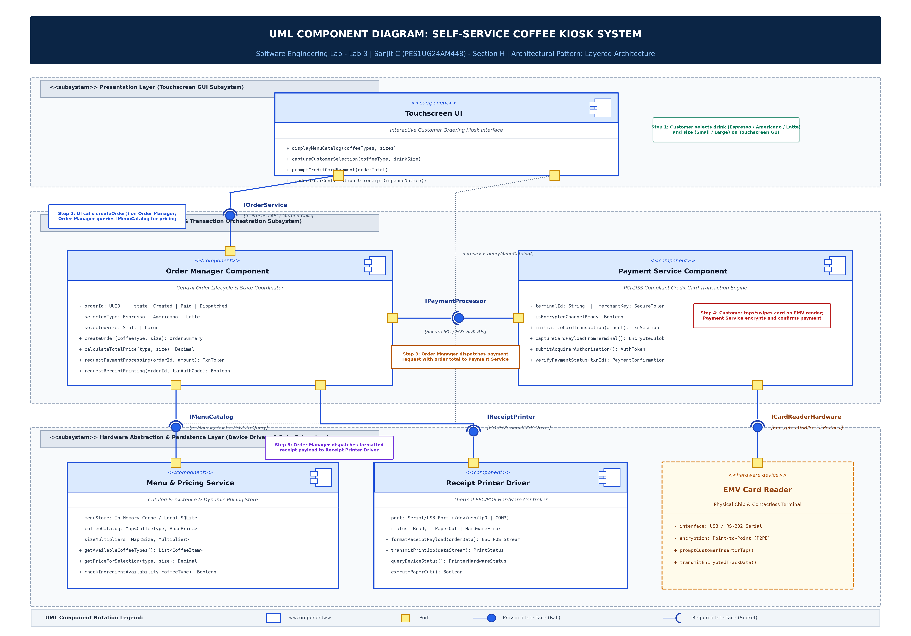

# Lab 3: Component Modelling & Architectural Pattern Selection

**Course:** Software Engineering Lab (Section H)  
**Student Name:** Sanjit C  
**SRN:** PES1UG24AM448  
**Scenario:** Self-Service Coffee Kiosk System  
**Selected Architectural Style:** Layered Architecture  

---

## 1. Scenario Summary & Requirements

Designing the software architecture for an on-premise **Self-Service Coffee Kiosk System** deployed in a busy café:
- **Core Functionality:**
  - 3 coffee types: Espresso, Americano, Latte
  - 2 drink sizes: Small, Large
  - Payment method: Credit card only
  - Hardware printing: Physical receipt with itemized order details
- **Technical Constraints:**
  - Responsive touchscreen interface interactions
  - Direct connection to ESC/POS thermal receipt printer hardware
  - High-speed local retrieval of menu data and pricing information
  - Autonomous edge operation independent of transient café Wi-Fi outages

---

## 2. Architecture Selection & Written Justification

> **"We chose Layered Architecture for the Self-Service Coffee Kiosk System."**

### Architectural Choice
A 3-Tier Layered Architecture structured into:
1. **Presentation Layer:** `Touchscreen UI`
2. **Business Logic Layer:** `Order Manager Component` and `Payment Service Component`
3. **Hardware Abstraction & Persistence Layer:** `Receipt Printer Driver`, `Menu & Pricing Service`, and `EMV Card Reader Interface`

### Two Scenario-Related Reasons for Selection
1. **Direct Hardware Abstraction & Peripheral Modularity:** The kiosk directly interfaces with physical peripherals (touchscreen monitor, ESC/POS thermal receipt printer, and EMV credit card reader). Layered architecture isolates hardware-specific drivers into the lowest tier behind clean interfaces (`IReceiptPrinter`, `ICardReaderHardware`). This completely decouples higher-level business logic (`Order Manager`) from hardware serial/USB communication protocols, allowing printers or card terminals to be upgraded without modifying order processing logic.
2. **Autonomous Edge Resilience & Offline Availability:** A busy café requires continuous operation regardless of Wi-Fi or Internet stability. Unlike a Client-Server or Microservices architecture that introduces network latency and single points of failure, the Layered kiosk executes in-process on the local embedded terminal. Menu browsing, price calculations, and receipt printing operate with 100% availability.

### Security Advantage (PCI-DSS Compliance via Layered Isolation)
Because credit card is the exclusive payment method, strict PCI-DSS data protection is required. The Layered pattern isolates payment processing and terminal hardware interaction inside a dedicated, encapsulated `Payment Service Component` behind the narrow `IPaymentProcessor` interface. Cardholder track data is encrypted at the hardware level and never transmitted to or logged in general memory. The `Order Manager` receives only sanitized authorization tokens, minimizing the attack surface and simplifying compliance audits.

### Performance Benefit (Zero-Latency In-Memory Execution)
Layered Architecture eliminates inter-service network serialization, socket management, and JSON parsing overhead. Inter-component method calls (`Touchscreen UI` → `Order Manager` → `Menu Service`) execute via sub-millisecond in-process invocations (< 2 ms). Rapid in-memory lookup of menu items and pricing ensures instantaneous 60 fps touch responsiveness, and receipts are dispatched to the printer immediately upon payment confirmation.

---

## 3. Component Breakdown

| Component Name | Layer / Tier | Core Responsibilities | Key Methods & State |
| :--- | :--- | :--- | :--- |
| **Touchscreen UI** | Presentation | Renders coffee items (Espresso, Americano, Latte), sizes (Small, Large); captures touch events; prompts payment; displays receipt status. | `+ displayMenu()` `+ captureSelection()` `+ promptPayment()` `+ showConfirmation()` |
| **Order Manager Component** | Business Logic | Coordinates order lifecycle (`Created` → `PaymentPending` → `Dispatched`); calculates totals; orchestrates payment and printing. | `- orderId: UUID` `- state: OrderState` `+ createOrder()` `+ calculateTotal()` `+ triggerPayment()` `+ dispatchPrint()` |
| **Payment Service Component** | Business Logic / Security | Enforces PCI-DSS credit card transaction processing; interfaces with EMV terminal; encrypts card data; submits authorization requests. | `- terminalId: String` `+ initCardTxn()` `+ captureCardData()` `+ submitAuth()` `+ verifyStatus()` |
| **Menu & Pricing Service** | Data & Persistence | Stores and maintains catalog of coffee items, base prices, drink size multipliers; provides in-memory query access. | `- menuStore: SQLite/Cache` `+ getCatalog()` `+ getPrice(type, size)` `+ checkStockAvailability()` |
| **Receipt Printer Driver** | Hardware Abstraction | Communicates with physical thermal printer over Serial/USB; formats ESC/POS byte-streams; monitors paper and device status. | `- port: SerialPort` `- status: DeviceState` `+ formatPayload()` `+ transmitPrintJob()` `+ checkPaperRoll()` `+ cutPaper()` |
| **EMV Card Reader** | Physical Hardware | Physical contactless NFC and EMV chip terminal handling card insertion, tap, and hardware Point-to-Point Encryption (P2PE). | `- P2PE Secure Crypto Engine` `+ promptTapOrInsert()` `+ emitEncryptedBlob()` |

---

## 4. Component Interface Specifications

| Interface Name | Provided By | Required By | Protocol / Mechanism | Key Operations & Data Flow |
| :--- | :--- | :--- | :--- | :--- |
| **`IOrderService`** | Order Manager | Touchscreen UI | In-Process API / Method Invocation | `createOrder(type, size): OrderSummary` `cancelOrder(id): Void` UI sends selections; receives order total and state. |
| **`IPaymentProcessor`** | Payment Service | Order Manager | Secure In-Process IPC / POS SDK | `processPayment(orderId, amt): TxnToken` `getTxnStatus(id): TxnResult` OM sends total; receives auth token & approval flag. |
| **`IMenuCatalog`** | Menu & Pricing Service | Order Manager & Touchscreen UI | In-Memory Direct Cache / Local SQLite | `getCoffeeTypes(): List<Item>` `getPrice(type, size): Decimal` Returns drink types, prices, and availability flags. |
| **`IReceiptPrinter`** | Receipt Printer Driver | Order Manager | ESC/POS Device Driver API | `printReceipt(receiptData): PrintStatus` `getPaperStatus(): DeviceState` Sends formatted text, timestamp, total, auth code. |
| **`ICardReaderHardware`** | EMV Card Reader Device | Payment Service | USB / RS-232 Encrypted Serial | `readCardData(): EncryptedBlob` `promptSwipeTap(): Void` Hardware transmits P2PE encrypted card payload. |

---

## 5. UML Component Diagram

---

## 6. Deliverable Files in this Repository

1. **`LAB3.pdf`** (Root directory): Complete 4-page formal submission document containing metadata, architectural analysis, written justification, component and interface specifications, high-resolution component diagram, and execution walkthrough.
2. **`LAB3/LAB3_Justification.docx`**: 1-page Word document formatted per submission guidelines with the exact required structure.
3. **`LAB3/LAB3_Justification.pdf`**: Standalone 1-page PDF export of the written justification.
4. **`LAB3/component_diagram.png`**: High-resolution (300 DPI) UML 2.0 Component Diagram with ball-and-socket notation, ports, dependencies, and subsystem boundaries.
5. **`LAB3/component_diagram.pdf`**: Vector PDF export of the component diagram.
