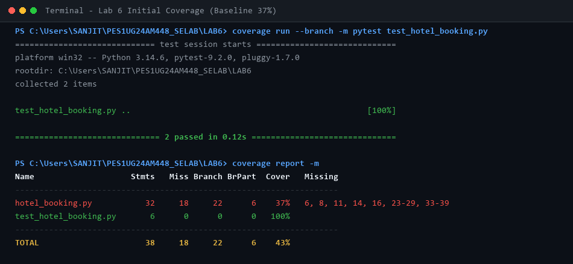
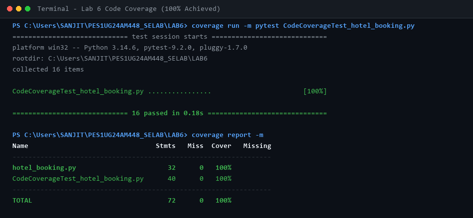
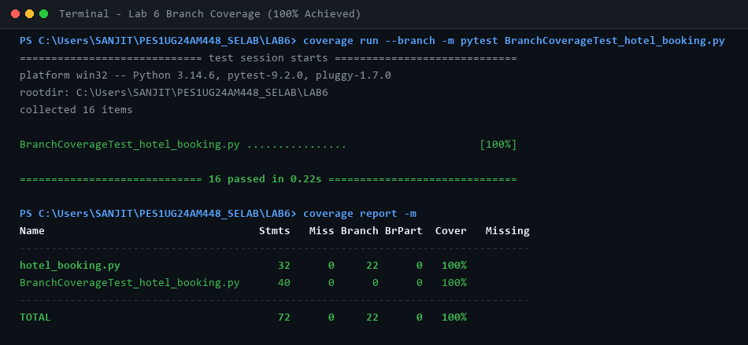

# Lab 6: Code and Branch Coverage Analysis

**Course:** Software Engineering Lab (Section H)  
**Student Name:** Sanjit C  
**SRN:** PES1UG24AM448  
**Repository Scenario:** `L6_L7_22_hotel_booking` (Lab 6)  

---

## 1. Overview & Objective
Systematically analyze and optimize line and branch coverage for the `hotel_booking.py` module using Python's `coverage` tool and `pytest`.

### Functions Under Test:
1. `booking_cost(room, nights, guests, is_peak_season)`: Calculates room charges, peak season surcharge (+25%), extra guest fees (+$500/night/guest above 2), and long stay discount (-10% for >= 7 nights).
2. `cancellation_refund(amount, days_before, is_member)`: Calculates tiered refunds (100% for >= 7 days, 50% for >= 2 days, 0% otherwise, with +25% bonus for members).
3. `room_upgrade(room, is_member, rooms_free)`: Upgrades standard to deluxe and deluxe to suite for members if rooms are free.

---

## 2. Coverage Results & Comparison

| Test Suite / Phase | Statements | Missed Stmts | Branches | Partial Branches | Coverage % |
| :--- | :---: | :---: | :---: | :---: | :---: |
| **Initial Starter Test** | 32 | 18 | 22 | 6 | **37%** (Failing) |
| **Code Coverage Test** | 32 | 0 | 22 | 0 | **100%** (Passed) |
| **Branch Coverage Test** | 32 | 0 | 22 | 0 | **100%** (Passed) |

---

## 3. Terminal Output Screenshots

### Step 4: Initial Starter Test Coverage (37% Baseline)


### Step 5 & 6: Code Coverage Run (100% Achieved)


### Step 7 & 8: Branch Coverage Run (100% Achieved)


---

## 4. Commands to Reproduce

```bash
# 1. Run line coverage
coverage run -m pytest CodeCoverageTest_hotel_booking.py
coverage report -m

# 2. Run branch coverage
coverage run --branch -m pytest BranchCoverageTest_hotel_booking.py
coverage report -m
```

---

## 5. Deliverables Included
- `hotel_booking.py`: Application module under test
- `CodeCoverageTest_hotel_booking.py`: Test suite verifying 100% statement execution
- `BranchCoverageTest_hotel_booking.py`: Test suite verifying 100% branch and decision paths
- `test_hotel_booking.py`: Complete test suite
- `screenshots/`: High-resolution terminal output screenshots
- `LAB6.pdf`: Formal complete submission report
