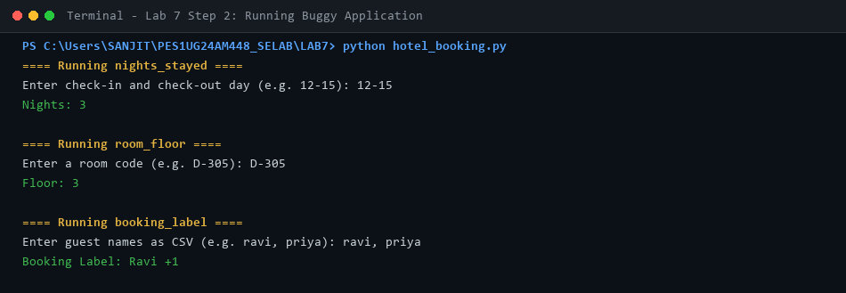
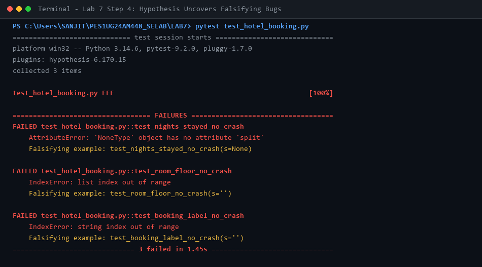
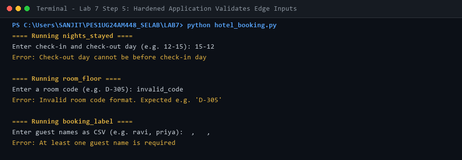
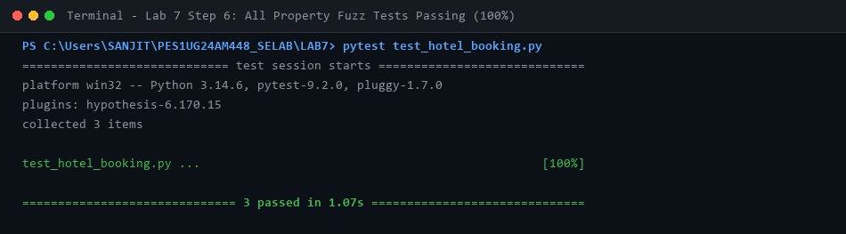

# Lab 7: Fuzzing for Input Validation Bugs with Hypothesis

**Course:** Software Engineering Lab (Section H)  
**Student Name:** Sanjit C  
**SRN:** PES1UG24AM448  
**Repository Scenario:** `L6_L7_22_hotel_booking` (Lab 7)  

---

## 1. Overview & Objective
Apply property-based fuzz testing using Python's `Hypothesis` library to uncover unhandled edge-case inputs, crashes, and validation bugs in `hotel_booking.py`, and refactor the code using defensive programming.

---

## 2. Bug Analysis Discovered by Hypothesis

1. **`nights_stayed(days)`**:
   - **Falsified by:** `s=None` and `s=""`
   - **Bug:** `AttributeError: 'NoneType' object has no attribute 'split'` when `None` was passed. Missing hyphens or non-integer tokens caused unhandled `ValueError` crashes.
   - **Defensive Fix:** Enforced string type check (`isinstance(days, str)`), hyphen presence check, safe unpack of exactly 2 parts, valid integer conversion, and verified `check_out >= check_in`.
2. **`room_floor(room_code)`**:
   - **Falsified by:** `s=None` and `s=""`
   - **Bug:** `IndexError: list index out of range` on `split('-')[1]` when hyphen was omitted; `IndexError` on empty room number; `ValueError` when non-digits were parsed.
   - **Defensive Fix:** Validated hyphen presence, verified non-empty room number part, verified `number[0].isdigit()`.
3. **`booking_label(names_csv)`**:
   - **Falsified by:** `s=None` and `s=""`
   - **Bug:** `IndexError: string index out of range` on `lead[0]` when input string was empty or contained only whitespace/commas.
   - **Defensive Fix:** Filtered out empty names (`[n.strip() for n in names if n.strip()]`), raised managed `ValueError` if list was empty.

---

## 3. Terminal Output Screenshots

### Step 2: Running Buggy Application


### Step 4: Hypothesis Uncovers Falsifying Inputs (Tests Failing)


### Step 5: Running Hardened Application with Error Handling


### Step 6: Re-Running Fuzz Tests on Hardened Code (100% Passing)


---

## 4. Commands to Reproduce

```bash
# Run property fuzz testing
pytest test_hotel_booking.py
```

---

## 5. Deliverables Included
- `hotel_booking.py`: Defensively hardened application script
- `hotel_booking_buggy.py`: Baseline buggy script
- `test_hotel_booking.py`: Completed Hypothesis property-based fuzz test suite
- `screenshots/`: Terminal screenshots of Step 2, Step 4, Step 5, and Step 6
- `LAB7.pdf`: Formal complete submission report with screenshots
